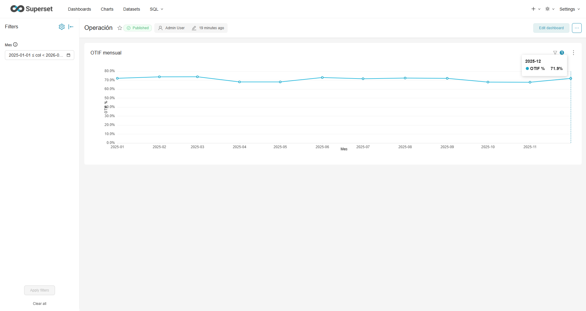
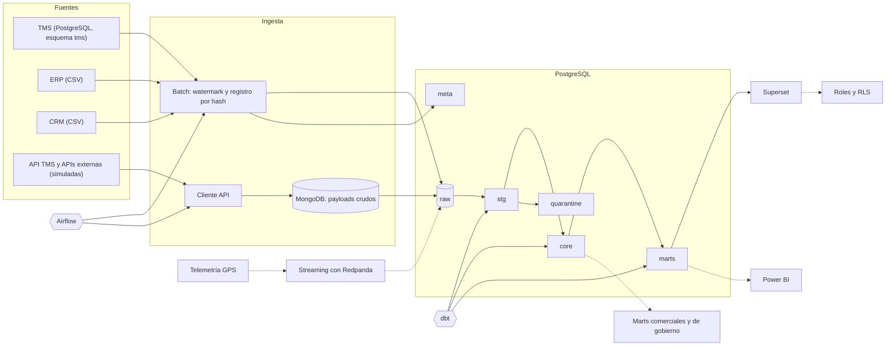

# Nexora Data Platform

Plataforma de analítica y gobierno de datos para una operación logística: ingesta de fuentes transaccionales y APIs, un data warehouse dimensional, indicadores de negocio, dashboards y controles de calidad y gobierno.

**Español** · [English](docs/README.en.md)

> **Aviso:** Nexora Logística es una empresa ficticia creada para este proyecto. Todos los datos son sintéticos. No se utiliza información de empresas ni de personas reales.

---

## Problema

La operación de Nexora Logística combina flota propia y transportadores terceros. La información vive dispersa en un TMS, un ERP, un CRM, archivos de Excel y APIs externas. Los reportes se arman a mano, cada área define sus indicadores a su manera y nadie puede decir qué tan confiable es un dato ni de dónde viene.

La plataforma resuelve tres cosas:

1. **Un solo número.** Cada indicador se define una vez y se calcula igual en todas partes.
2. **Trazabilidad.** Cada fila se puede seguir desde la fuente hasta el dashboard.
3. **Confianza medible.** La calidad y la frescura se monitorean, no se suponen.

## Arquitectura

Las líneas continuas funcionan hoy; las punteadas son extensiones que todavía no están en `main`. Las capas y sus contratos están descritos en [`docs/04_architecture.md`](docs/04_architecture.md).

### Stack

| Componente | Herramienta |
|---|---|
| Base relacional y warehouse | PostgreSQL 16 |
| Documentos y telemetría | MongoDB 7 |
| Transformación | dbt-core |
| Orquestación | Apache Airflow 3.4 |
| BI | Apache Superset 6 |
| Streaming (extensión, no incluida en `main`) | Redpanda |
| Contenedores | Docker Compose |

## Qué hace hoy

- **Entorno local.** Docker Compose con PostgreSQL, MongoDB y Airflow, con healthchecks ([`docker-compose.yml`](docker-compose.yml)), y un perfil de BI con Superset y Redis ([`docker-compose.bi.yml`](docker-compose.bi.yml)). Esquemas `tms`, `raw`, `stg`, `quarantine`, `core`, `marts` y `meta`, con roles separados para publicar, cargar y leer ([`infra/postgres/init`](infra/postgres/init)).
- **Generador sintético.** Perfiles `demo` (50 000 envíos), `local` (200 000) y `benchmark` (2 000 000) para el TMS, el ERP y el CRM ([`cli.py`](src/nexora/generators/cli.py)); inyecta defectos registrados en un manifiesto ([`defects.py`](src/nexora/generators/defects.py)) y separa cerca del 3 % de las filas de ERP y CRM como archivos tardíos ([`late_files.py`](src/nexora/generators/late_files.py)).
- **Ingesta batch.** Extracción incremental de `tms` a `raw` por watermark de cada tabla ([`watermark.py`](src/nexora/ingestion/batch/watermark.py)) y carga de los archivos ERP y CRM con registro por hash, primero la carpeta principal y después los tardíos ([`loaders.py`](src/nexora/ingestion/batch/loaders.py)). Repetir una ingesta sin cambios no inserta filas y `raw` es append-only. El DAG diario [`dag_ingest_batch`](airflow/dags/dag_ingest_batch.py) ejecuta las dos vías.
- **Ingesta de APIs.** API TMS simulada con token Bearer, paginación, fallos y cambios de esquema deterministas ([`app.py`](src/nexora/generators/api/app.py)); cliente HTTP con reintentos, backoff, `Retry-After` y límite de tasa ([`client.py`](src/nexora/ingestion/api/client.py)); detección de cambios de esquema que bloquea la ejecución ([`drift.py`](src/nexora/ingestion/api/drift.py)); aterrizaje del payload crudo en MongoDB ([`landing.py`](src/nexora/ingestion/api/landing.py)) y DAG horario [`dag_ingest_apis`](airflow/dags/dag_ingest_apis.py), pausado al crearse. dbt tipa los recursos en [`staging/api`](dbt/models/staging/api) y publica los elementos válidos en `core_api__*` ([`core_api__shipments.sql`](dbt/models/core/api/core_api__shipments.sql)).
- **Staging y cuarentena.** Cada dominio tipa, deduplica y valida en staging ([`stg_tms__shipments_validated.sql`](dbt/models/staging/tms/stg_tms__shipments_validated.sql)) y separa las filas rechazadas en `quarantine`, con regla y motivo ([`quarantine/shipments.sql`](dbt/models/quarantine/shipments.sql)).
- **Core de envíos y mart.** Dimensiones de cliente, carrier, ruta, tipo de servicio y fecha; el hecho [`fact_shipments`](dbt/models/core/facts/fact_shipments.sql) y el mart diario [`mart_operations`](dbt/models/marts/operations/mart_operations.sql), con los conteos de OTIF, OTD e In Full, conciliado con el hecho por un test de dbt ([`assert_mart_reconciles_fact_shipments.sql`](dbt/tests/assert_mart_reconciles_fact_shipments.sql)).
- **Core operativo.** Dimensiones SCD2 con miembro inferido [`dim_vehicle`](dbt/models/core/dimensions/dim_vehicle.sql) y [`dim_driver`](dbt/models/core/dimensions/dim_driver.sql); hechos de viajes ([`fact_trips`](dbt/models/core/facts/fact_trips.sql)), eventos de envío ([`fact_shipment_events`](dbt/models/core/facts/fact_shipment_events.sql)) y combustible ([`fact_fuel_transactions`](dbt/models/core/facts/fact_fuel_transactions.sql)); tabla puente envío–viaje que reparte los kilómetros en vacío del viaje por peso o volumen por kilómetro cargado, o en partes iguales ([`bridge_shipment_trip`](dbt/models/core/bridge/bridge_shipment_trip.sql)).
- **Core financiero.** Tarifas SCD2 ([`dim_tariff`](dbt/models/core/dimensions/dim_tariff.sql)); facturación por línea de factura con su pago ([`fact_invoices`](dbt/models/core/facts/fact_invoices.sql)), liquidaciones a carriers ([`fact_carrier_settlements`](dbt/models/core/facts/fact_carrier_settlements.sql)) y costos por envío y componente ([`fact_shipment_costs`](dbt/models/core/facts/fact_shipment_costs.sql)), con los montos en su moneda original.
- **Incidencias y ofertas.** Hechos de incidencias de carriers ([`fact_carrier_incidents`](dbt/models/core/facts/fact_carrier_incidents.sql)) y de ofertas de carga con su respuesta ([`fact_carrier_tenders`](dbt/models/core/facts/fact_carrier_tenders.sql)), ligados a `fact_shipments` y `dim_carrier`.
- **BI.** Dashboard de operación en Superset ([`operations_overview.yaml`](dashboards/superset/dashboards/operations_overview.yaml)) con el OTIF mensual ([`otif_monthly.yaml`](dashboards/superset/charts/otif_monthly.yaml)), versionado en YAML e importable con `make import-superset` ([`import_superset.sh`](scripts/import_superset.sh)), sobre una conexión de solo lectura.
- **CI y estructura.** GitHub Actions ejecuta ruff, black, pytest, `dbt parse` y la verificación de estructura ([`ci.yml`](.github/workflows/ci.yml)); un segundo workflow ([`structure-guard.yml`](.github/workflows/structure-guard.yml)) aplica la allowlist de rutas de [`verify_structure.py`](scripts/verify_structure.py). sqlfluff corre en local con `make lint` y en pre-commit.
- **Mediciones.** Tiempo, memoria y disco del generador y de la ingesta batch, en [`tms_generator_scale.md`](benchmarks/results/tms_generator_scale.md) y [`erp_crm_generator_scale.md`](benchmarks/results/erp_crm_generator_scale.md).

## Resultados medidos

Cifras copiadas de las mediciones publicadas. Describen una máquina, un volumen y unos comandos concretos, detallados en cada tabla completa.

Generador TMS, publicación en `tms` y extracción a `raw`, medición del 2026-11-15 ([tabla completa](benchmarks/results/tms_generator_scale.md)):

| Métrica | Valor | Fecha | Artefacto |
|---|---|---|---|
| `benchmark`: generación, tiempo | 4:51.40 (min:s) | 2026-11-15 | `data/tmp/time_benchmark.txt` |
| `benchmark`: generación, RSS máximo | 218 648 KB (213,5 MiB) | 2026-11-15 | `data/tmp/time_benchmark.txt` |
| `benchmark`: generación, disco | 3 634 233 068 B (3,63 GB) | 2026-11-15 | `du -sb data/tmp/benchmark` |
| `local`: publicación, tiempo | 0:59.74 (min:s) | 2026-11-15 | `data/tmp/time_local_publish.txt` |
| `local`: extracción, tiempo | 0:26.95 (min:s) | 2026-11-15 | `data/tmp/time_local_extract.txt` |

Generador ERP/CRM y carga de archivos a `raw`, medición del 2026-11-16 ([tabla completa](benchmarks/results/erp_crm_generator_scale.md)):

| Métrica | Valor | Fecha | Artefacto |
|---|---|---|---|
| `benchmark`: generación, tiempo | 6:16.20 (min:s) | 2026-11-16 | `data/tmp/time_benchmark.txt` |
| `benchmark`: generación, disco | 4 537 439 291 B (4,54 GB) | 2026-11-16 | `du -sb data/tmp/benchmark` |
| `local`: carga de la carpeta, tiempo | 0:04.94 (min:s) | 2026-11-16 | `data/tmp/time_local_load.txt` |
| `local`: carga de `late/`, tiempo | 0:00.34 (min:s) | 2026-11-16 | `data/tmp/time_local_load_late.txt` |

### Tamaño del proyecto

Conteo del 2026-11-23 sobre el repositorio, con `find`, `ls`, `dbt ls --resource-type test` y `pytest --collect-only -q`:

| Elemento | Cantidad |
|---|---|
| Modelos dbt en `staging` | 64 |
| Modelos dbt en `quarantine` | 5 |
| Modelos dbt en `core` | 21 |
| Modelos dbt en `marts` | 1 |
| Tests singulares de dbt (`dbt/tests/`) | 28 |
| Tests de dbt (genéricos y singulares) | 326 |
| DAGs de Airflow | 3 |
| Tests de pytest recogidos | 425 |
| ADRs | 5 |
