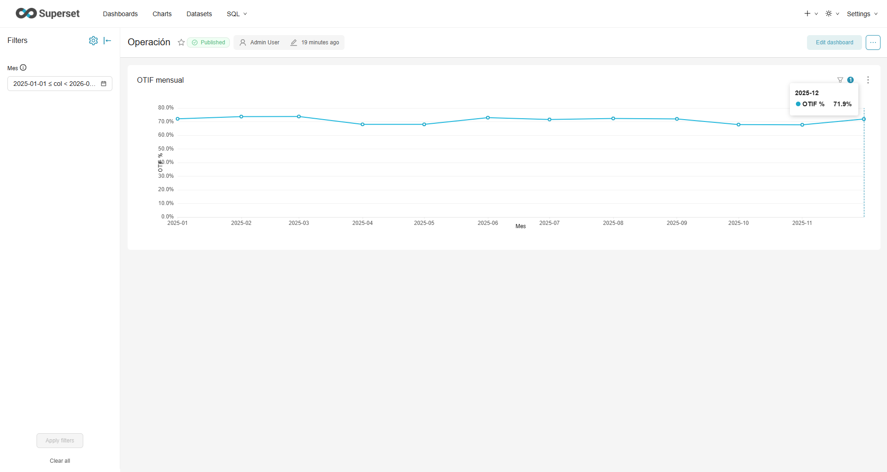
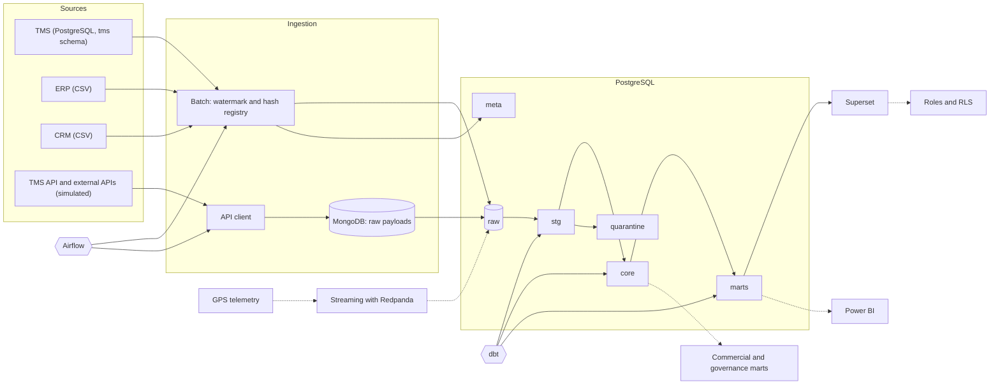
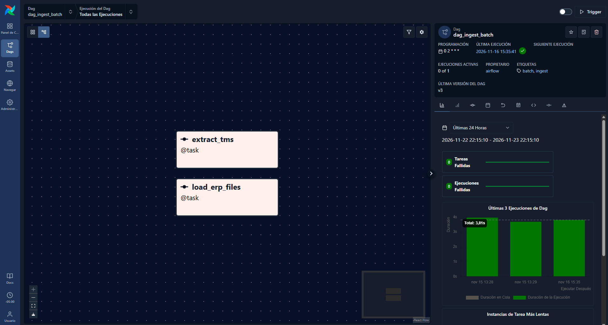
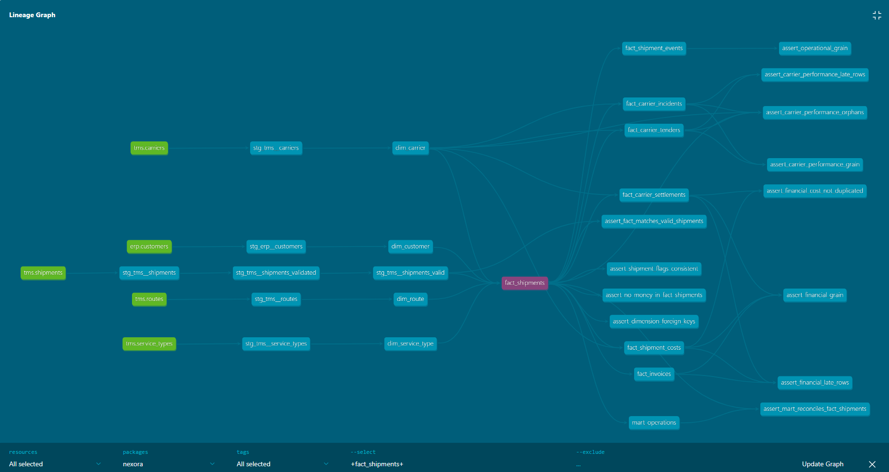

# Nexora Data Platform

Analytics and data governance platform for a logistics operation: ingestion of transactional sources and APIs, a dimensional data warehouse, business indicators, dashboards, and quality and governance controls.

[Español](../README.md) · **English**

[](https://github.com/jusrojasrod/logistics-data-platform/actions/workflows/ci.yml)
[](https://github.com/jusrojasrod/logistics-data-platform/actions/workflows/structure-guard.yml)
[](../LICENSE)


> **Notice:** Nexora Logística is a fictitious company created for this project. All data is synthetic. No information from real companies or people is used.



## Problem

Nexora Logística runs its own fleet alongside third-party carriers. Its information is scattered across a TMS, an ERP, a CRM, Excel files and external APIs. Reports are assembled by hand, each area defines its indicators its own way, and nobody can say how reliable a figure is or where it comes from.

The platform solves three things:

1. **One number.** Each indicator is defined once and computed the same way everywhere.
2. **Traceability.** Every row can be followed from the source to the dashboard.
3. **Measurable trust.** Quality and freshness are monitored, not assumed.

## Architecture



Solid lines work today; dotted lines are extensions not yet in `main`. The layers and their contracts are described in [`04_architecture.md`](04_architecture.md) (in Spanish, like the rest of `docs/`).

### Stack

| Component | Tool |
|---|---|
| Relational database and warehouse | PostgreSQL 16 |
| Documents and telemetry | MongoDB 7 |
| Transformation | dbt-core |
| Orchestration | Apache Airflow 3.4 |
| BI | Apache Superset 6 |
| Streaming (extension, not included in `main`) | Redpanda |
| Containers | Docker Compose |

## What it does today

- **Local environment.** Docker Compose with PostgreSQL, MongoDB and Airflow, with healthchecks ([`docker-compose.yml`](../docker-compose.yml)), and a BI profile with Superset and Redis ([`docker-compose.bi.yml`](../docker-compose.bi.yml)). Schemas `tms`, `raw`, `stg`, `quarantine`, `core`, `marts` and `meta`, with separate roles to publish, load and read ([`infra/postgres/init`](../infra/postgres/init)).
- **Synthetic generator.** Profiles `demo` (50 000 shipments), `local` (200 000) and `benchmark` (2 000 000) for the TMS, the ERP and the CRM ([`cli.py`](../src/nexora/generators/cli.py)); it injects defects recorded in a manifest ([`defects.py`](../src/nexora/generators/defects.py)) and sets aside about 3 % of the ERP and CRM rows as late files ([`late_files.py`](../src/nexora/generators/late_files.py)).
- **Batch ingestion.** Incremental extraction from `tms` to `raw` by a per-table watermark ([`watermark.py`](../src/nexora/ingestion/batch/watermark.py)) and loading of the ERP and CRM files with a hash registry, first the main folder and then the late files ([`loaders.py`](../src/nexora/ingestion/batch/loaders.py)). Re-running an ingestion without source changes inserts no rows, and `raw` is append-only. The daily DAG [`dag_ingest_batch`](../airflow/dags/dag_ingest_batch.py) runs both paths.
- **API ingestion.** Simulated TMS API with Bearer token, pagination, and deterministic faults and schema changes ([`app.py`](../src/nexora/generators/api/app.py)); HTTP client with retries, backoff, `Retry-After` and rate limiting ([`client.py`](../src/nexora/ingestion/api/client.py)); schema-change detection that blocks the run ([`drift.py`](../src/nexora/ingestion/api/drift.py)); landing of the raw payload in MongoDB ([`landing.py`](../src/nexora/ingestion/api/landing.py)) and the hourly DAG [`dag_ingest_apis`](../airflow/dags/dag_ingest_apis.py), paused on creation. dbt types the resources in [`staging/api`](../dbt/models/staging/api) and publishes the valid items in `core_api__*` ([`core_api__shipments.sql`](../dbt/models/core/api/core_api__shipments.sql)).
- **Staging and quarantine.** Each domain types, deduplicates and validates in staging ([`stg_tms__shipments_validated.sql`](../dbt/models/staging/tms/stg_tms__shipments_validated.sql)) and moves rejected rows to `quarantine`, with rule and reason ([`quarantine/shipments.sql`](../dbt/models/quarantine/shipments.sql)).
- **Shipments core and mart.** Customer, carrier, route, service type and date dimensions; the fact [`fact_shipments`](../dbt/models/core/facts/fact_shipments.sql) and the daily mart [`mart_operations`](../dbt/models/marts/operations/mart_operations.sql), with the OTIF, OTD and In Full counts, reconciled with the fact by a dbt test ([`assert_mart_reconciles_fact_shipments.sql`](../dbt/tests/assert_mart_reconciles_fact_shipments.sql)).
- **Operational core.** SCD2 dimensions with inferred member [`dim_vehicle`](../dbt/models/core/dimensions/dim_vehicle.sql) and [`dim_driver`](../dbt/models/core/dimensions/dim_driver.sql); facts for trips ([`fact_trips`](../dbt/models/core/facts/fact_trips.sql)), shipment events ([`fact_shipment_events`](../dbt/models/core/facts/fact_shipment_events.sql)) and fuel ([`fact_fuel_transactions`](../dbt/models/core/facts/fact_fuel_transactions.sql)); a shipment–trip bridge table that allocates the trip's empty kilometres by weight or volume times loaded kilometres, or in equal parts ([`bridge_shipment_trip`](../dbt/models/core/bridge/bridge_shipment_trip.sql)).
- **Financial core.** SCD2 tariffs ([`dim_tariff`](../dbt/models/core/dimensions/dim_tariff.sql)); invoicing per invoice line with its payment ([`fact_invoices`](../dbt/models/core/facts/fact_invoices.sql)), carrier settlements ([`fact_carrier_settlements`](../dbt/models/core/facts/fact_carrier_settlements.sql)) and costs per shipment and component ([`fact_shipment_costs`](../dbt/models/core/facts/fact_shipment_costs.sql)), with amounts in their original currency.
- **Incidents and tenders.** Facts for carrier incidents ([`fact_carrier_incidents`](../dbt/models/core/facts/fact_carrier_incidents.sql)) and load tenders with their response ([`fact_carrier_tenders`](../dbt/models/core/facts/fact_carrier_tenders.sql)), linked to `fact_shipments` and `dim_carrier`.
- **BI.** Operations dashboard in Superset ([`operations_overview.yaml`](../dashboards/superset/dashboards/operations_overview.yaml)) with monthly OTIF ([`otif_monthly.yaml`](../dashboards/superset/charts/otif_monthly.yaml)), versioned as YAML and importable with `make import-superset` ([`import_superset.sh`](../scripts/import_superset.sh)), over a read-only connection. Dashboard labels are in Spanish.
- **CI and structure.** GitHub Actions runs ruff, black, pytest, `dbt parse` and the structure check ([`ci.yml`](../.github/workflows/ci.yml)); a second workflow ([`structure-guard.yml`](../.github/workflows/structure-guard.yml)) enforces the path allowlist of [`verify_structure.py`](../scripts/verify_structure.py). sqlfluff runs locally with `make lint` and in pre-commit.
- **Measurements.** Time, memory and disk of the generator and the batch ingestion, in [`tms_generator_scale.md`](../benchmarks/results/tms_generator_scale.md) and [`erp_crm_generator_scale.md`](../benchmarks/results/erp_crm_generator_scale.md).

## Measured results

Figures copied from the published measurements; the machine, the volume and the commands are in each full table. TMS generator, publishing to `tms` and extraction to `raw`, measured on 2026-11-15 ([full table](../benchmarks/results/tms_generator_scale.md)):

| Metric | Value | Date | Artifact |
|---|---|---|---|
| `benchmark`: generation, time | 4:51.40 (min:s) | 2026-11-15 | `data/tmp/time_benchmark.txt` |
| `benchmark`: generation, max RSS | 218 648 KB (213,5 MiB) | 2026-11-15 | `data/tmp/time_benchmark.txt` |
| `benchmark`: generation, disk | 3 634 233 068 B (3,63 GB) | 2026-11-15 | `du -sb data/tmp/benchmark` |
| `local`: publishing, time | 0:59.74 (min:s) | 2026-11-15 | `data/tmp/time_local_publish.txt` |
| `local`: extraction, time | 0:26.95 (min:s) | 2026-11-15 | `data/tmp/time_local_extract.txt` |

ERP/CRM generator and file loading to `raw`, measured on 2026-11-16 ([full table](../benchmarks/results/erp_crm_generator_scale.md)):

| Metric | Value | Date | Artifact |
|---|---|---|---|
| `benchmark`: generation, time | 6:16.20 (min:s) | 2026-11-16 | `data/tmp/time_benchmark.txt` |
| `benchmark`: generation, disk | 4 537 439 291 B (4,54 GB) | 2026-11-16 | `du -sb data/tmp/benchmark` |
| `local`: folder load, time | 0:04.94 (min:s) | 2026-11-16 | `data/tmp/time_local_load.txt` |
| `local`: `late/` load, time | 0:00.34 (min:s) | 2026-11-16 | `data/tmp/time_local_load_late.txt` |

### Project size

Count of 2026-11-23 over the repository, with `find`, `ls`, `dbt ls --resource-type test` and `pytest --collect-only -q`:

| Item | Count |
|---|---|
| dbt models in `staging` | 64 |
| dbt models in `quarantine` | 5 |
| dbt models in `core` | 21 |
| dbt models in `marts` | 1 |
| dbt singular tests (`dbt/tests/`) | 28 |
| dbt tests (generic and singular) | 326 |
| Airflow DAGs | 3 |
| Collected pytest tests | 425 |
| ADRs | 5 |

## Gallery


*Operations dashboard in Superset: monthly OTIF over `mart_operations`.*



*Airflow, Graph view of `dag_ingest_batch`: the `extract_tms` and `load_erp_files` tasks, with no dependency between them, and the DAG panel with the `0 2 * * *` schedule and the last successful run.*



*dbt docs, `+fact_shipments+` lineage: TMS and ERP sources, staging, dimensions, `fact_shipments` and what depends on it (financial, incident, tender and event facts, `mart_operations` and singular tests).*

## Indicators

| Indicator | Calculation | Measurement |
|---|---|---|
| OTIF, OTD, In Full | `mart_operations` and operations dashboard | to be measured |
| Cost per shipment, gross margin | pending (the facts exist, the mart is missing) | to be measured |
| Deadhead and fleet utilization | pending | to be measured |
| Data quality (DQ Score) | pending | to be measured |
| Query performance | reference query in `benchmarks/queries/` | to be measured |
| Scale of the generator and the batch ingestion | generation, publishing, extraction and loading | measured in [`benchmarks/results/`](../benchmarks/results/) |

**To be measured** means there is no published measurement backing the figure yet. The full catalog, with formula and grain, is in [`02_kpi_catalog.md`](02_kpi_catalog.md).

## Technical decisions

- [ADR-001](adr/ADR-001-postgresql.md): PostgreSQL as the main engine.
- [ADR-002](adr/ADR-002-medallion.md): layered architecture.
- [ADR-003](adr/ADR-003-dbt.md): dbt for transformations.
- [ADR-004](adr/ADR-004-airflow-3.md): Airflow 3.
- [ADR-005](adr/ADR-005-superset.md): Apache Superset as the BI tool.
- **SCD2 with inferred member** for facts that arrive before their dimension: [`dim_vehicle`](../dbt/models/core/dimensions/dim_vehicle.sql) and [`dim_driver`](../dbt/models/core/dimensions/dim_driver.sql).
- **Quarantine with rule and reason**, not just failing tests: [`dbt/models/quarantine/`](../dbt/models/quarantine).
- **Append-only `raw`**, with a per-table watermark ([`watermark.py`](../src/nexora/ingestion/batch/watermark.py)) and a file registry by hash ([`loaders.py`](../src/nexora/ingestion/batch/loaders.py)).
- **Amounts in their original currency**, with `currency_code`: [`fact_invoices`](../dbt/models/core/facts/fact_invoices.sql).
- **Allocation in the bridge table** of empty kilometres, without amounts that duplicate the costs: [`bridge_shipment_trip`](../dbt/models/core/bridge/bridge_shipment_trip.sql).

## Roadmap

### Done

- Local environment, synthetic generator and batch ingestion ([`dag_ingest_batch.py`](../airflow/dags/dag_ingest_batch.py)).
- API ingestion with landing in MongoDB, its own staging and core ([`dag_ingest_apis.py`](../airflow/dags/dag_ingest_apis.py)).
- Staging with quarantine, shipments core and operations mart ([`mart_operations.sql`](../dbt/models/marts/operations/mart_operations.sql)).
- Operational core: SCD2 fleet, trips, events, fuel and bridge table ([`bridge_shipment_trip.sql`](../dbt/models/core/bridge/bridge_shipment_trip.sql)).
- Financial core, incidents and tenders ([`fact_invoices.sql`](../dbt/models/core/facts/fact_invoices.sql), [`fact_carrier_tenders.sql`](../dbt/models/core/facts/fact_carrier_tenders.sql)).
- Operations dashboard, CI and scale measurements ([`operations_overview.yaml`](../dashboards/superset/dashboards/operations_overview.yaml), [`ci.yml`](../.github/workflows/ci.yml), [`tms_generator_scale.md`](../benchmarks/results/tms_generator_scale.md)).

### In progress

- Nothing under active development; next is the first line of Pending.

### Pending

- Commercial and governance marts, financial KPIs and carrier scorecard.
- Quality (DQ Score) and freshness baseline, and query benchmark.
- Commercial and governance dashboards, roles and RLS in Superset, access through Cloudflare Tunnel and Access, and the Power BI documentation annex.
- Data governance: catalog and lineage in `meta`, PII classification and masking, retention by layer and access matrix.
- Deployment on Oracle Cloud, CD, backups and observability.
- Extension: GPS telemetry streaming with Redpanda and an ETA prediction model.

## Quick start

```bash
cp .env.example .env        # fill in local secrets
make up                     # postgres, mongo, airflow
make ps
make data                   # synthetic data in data/demo (default profile)
make up-bi                  # adds superset and redis
make import-superset        # imports the versioned dashboard
```

`make data SCALE=local` generates the `local` profile in `data/local`. Publishing to `tms`, extraction to `raw`, file loading and dbt operation are in the [runbook](07_runbook.md); `make dbt-build` builds and tests the models. Airflow runs at `http://localhost:8080` and Superset at `http://localhost:8088`. No service is exposed outside the local machine.

## Structure

```text
docs/          context, KPI catalog, dictionary, architecture, governance, runbook, ADRs
dbt/           staging, quarantine, core and marts models; tests
src/nexora/    synthetic generator, ingestion connectors and configuration
airflow/       DAGs and plugins
infra/         Postgres initialization, images, Superset, tunnel
dashboards/    versioned Superset definitions
benchmarks/    queries and measured results
tests/         unit and integration
```

## Documentation

[Business context](01_business_context.md) · [KPI catalog](02_kpi_catalog.md) · [Data dictionary](03_data_dictionary.md) · [Architecture](04_architecture.md) · [Data governance](05_governance_policy.md) · [Quality rules](06_quality_rules.md) · [Runbook](07_runbook.md)

## License

MIT. See [`LICENSE`](../LICENSE).
